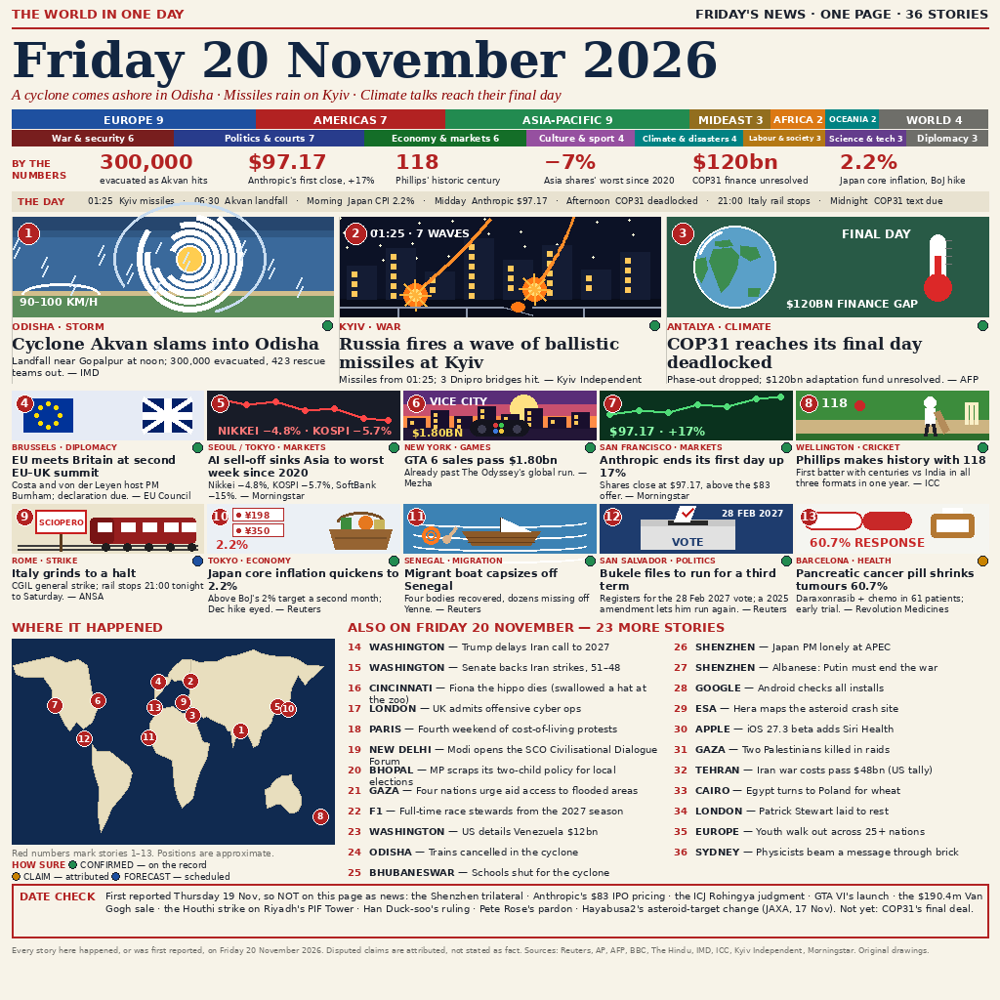

# Friday 20 November 2026 — one front page

[](https://make.fun/bounty/news-image-20261120?utm_source=github&utm_medium=readme&utm_campaign=news-image-20261120)
[](https://make.fun/bounty/news-image-20261120/leaderboard?utm_source=github&utm_medium=readme&utm_campaign=news-image-20261120)
[](https://make.fun/bounty/news-image-20261120?utm_source=github&utm_medium=readme&utm_campaign=news-image-20261120)



One page of world news: **36 stories**, every one of which happened or
was first reported on Friday 20 November 2026. Three large leads
(Cyclone Akvan, the Kyiv missile strike, COP31's final day), ten
featured stories, and 23 more briefs — with a region bar, a by-field
bar, a by-the-numbers strip, a timeline of the day, a map of where it
happened, and a date-check box listing the 19 November stories that
were left out on purpose.

## Build

```sh
python3 main.py
```

That runs `draw.py` (Pillow, standard DejaVu/Liberation fonts) and
writes `entry.png` (1024×1024, deterministic). The story list lives
in `STORIES.md`; the winner study that shaped this version is in
`news-image-20261120-v4-study.md` (in the make.fun workspace, not this
repo).

## Why 36 stories

The 20 November top 10 runs 24–40 stories (mean 34). Our 69-story
version scored 971,449 (rank #1,182) — 15,125 below the top-50 cutoff —
while 36-story pages top the board. Fewer, better stories, more space,
more legible type. The leads follow the winners' consensus trio:
Akvan, Kyiv, COP31.

## Sources

Reuters, AP, AFP, BBC, The Hindu, IMD, ICC, Kyiv Independent,
Morningstar. Disputed claims are attributed, not stated as fact.
Original drawings, made in code.
